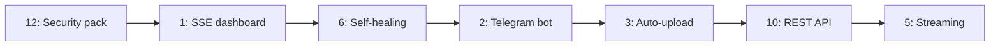

update version accordingly, by our changes, all over the codebase

Based on research into aria2, AriaNg, SABnzbd, and pyLoad — and what fits your existing stack (PHP 8.3, flat files, yt-dlp, ffmpeg already present) — here's a roadmap to make Rapidleech genuinely professional:

## 🚀 Tier 1 — "Wow" Features (highest impact)

| # | Feature | Why it glows | How it fits your codebase |
|---|---|---|---|
| 1 | **Live SSE dashboard** — real-time speed graphs, per-chunk visualization, ETA | Replaces 3s AJAX polling; feels like AriaNg | PHP Server-Sent Events endpoint reading `downloads.lst` + `download_queue.json`; chart.js |
| 2 | **Telegram Bot control** — send links to bot, get notified + fetch files back | Killer feature for this product category; your audience already uses TG | Long-polling bot script via cron; reuses `files.lst` ownership tokens as chat-linking |
| 3 | **Auto-upload pipeline** — after download → auto-push to Telegram/GDrive/S3-R2, then free local space | Turns leecher into a relay; R2 = zero egress fees | Hook after `geturl()` completes; you already have upload plugins + ffmpeg |
| 4 | **Smart link analyzer** — paste any page URL → see thumbnails, durations, sizes, quality options *before* downloading | yt-dlp already gives you all metadata via `--dump-json` | Extend `ytdlp_universal.php` preview step into a rich media card grid |
| 5 | **In-browser streaming** — watch videos directly with range requests + HLS transcode | No download needed; huge perceived value | PHP range-streaming script + ffmpeg HLS; files already on disk |

## 🧠 Tier 2 — Intelligence & Reliability

| # | Feature | Details |
|---|---|---|
| 6 | **Self-healing downloads** — stall detection, auto-retry with exponential backoff, checksum verification (SHA-256), disk-fit prediction before starting | Watchdog cron reading `downloads.lst` PIDs; refuse downloads that won't fit |
| 7 | **Dedup cache** — two users requesting the same URL share one download | Hash the URL → single worker, fan-out on completion. Massive bandwidth saver on public instances |
| 8 | **Scheduler + bandwidth QoS** — off-peak downloads, per-user/global speed caps (token bucket), priority queue with drag-reorder | aria2-style throttling in `classes/http.php` chunk loop |
| 9 | **Analytics dashboard** — bandwidth over time, top users, storage forecasting from your existing `activity.log` JSON | You already collect the data; just visualize it |

## 🏗️ Tier 3 — Platform & Trust

| # | Feature | Details |
|---|---|---|
| 10 | **REST API + API keys** — `POST /api/v1/downloads`, OpenAPI docs; lets power users script it and external frontends (AriaNg-style) connect | Token auth layer in `rl_init.php`; JSON endpoints beside `ajax.php` |
| 11 | **Multi-node mode** — master queue + worker nodes; download on cheapest server, serve from nearest | Your flat-file queue becomes a Redis-free JSON sync; workers poll master |
| 12 | **Security hardening pack** — CSRF tokens, TOTP 2FA for admin, login lockout, rate limiting, Turnstile captcha, Secure cookies + HSTS, replace Blowfish with Sodium | Directly addresses the gaps in your current security notes |
| 13 | **User quotas & invite system** — per-user storage/bandwidth caps, expiry, invite codes | Extends your existing cookie-token ownership model |
| 14 | **PWA** — installable app, push notification "download complete", offline file list | Manifest + service worker on the flavor template |
| 15 | **Plugin marketplace** — one-click install/update of download plugins from a registry, with version pinning | `site_checker.php` becomes a manifest; admin panel gets an "Install" tab |

## My recommended order

**Start with #12 (security)** — it's the foundation everything professional rests on. Then **#1 + #6** make the core product feel bulletproof. **#2 + #3** are the viral growth features. Want me to start implementing any of these?

---

## Progress

### #12 Security hardening pack — CSRF protection ✅ (v2.5.0, rev 44, 23Oct2026)

- `rl_init.php` — named session (`rl_session`), `rl_csrf_token()` / `rl_csrf_field()` / `rl_csrf_validate()` helpers (hash_equals, POST field or `X-RL-CSRF` header)
- `classes/other.php` — `GetDefaultParams()` injects the token, covering all plugin redirect chains (DownloadClass audl chaining, yt-dlp forms)
- `index.php`, `audl.php`, `auul.php`, `local_upload.php`, `notes.php` — POST validation + form fields
- `templates/flavor/main.php`, `templates/neatblue/main.php` — transload/flist forms + local-upload XHR carry the token
- `hosts/download/ytdlp_universal.php` — flist form field
- `ajax.php` — session name aligned with `rl_session`
- `admin/index.php` — stateless HMAC token derived from admin credentials, all 10 POST forms covered

Verified: POST without token → rejected; with token → normal flow (index, audl, local_upload, admin).

### Drag & drop local upload ✅ (v2.5.0, rev 45, 23Oct2026)

- `templates/flavor/main.php` — Local Upload tab now has a drag & drop zone (click still works via the Choose File button); chosen file name + size shown as a pill; dropped file is assigned to the existing `#localfile` input so the upload flow is unchanged
- `templates/flavor/styles/rl_style_pm.css` — `.fl-dropzone` styles with dashed border, hover highlight, and drag-over glow using existing theme variables

### Real visitor counter badge ✅ (v2.5.0, rev 47, 23Oct2026)

- `rl_init.php` — `rl_count_visit()` counts index.php page loads into `configs/visits.json` (flock-protected; today resets on date rollover, unique per USER_TOKEN cookie, total counts all loads); CREDITS footer badge now points to the self-hosted endpoint instead of hits.sh
- `ajax.php` — public `visitor_badge` case renders a for-the-badge style SVG (label "Visitors", value `today / total`), `no-store` cache headers, graceful 0 / 0 fallback if the data file is missing

### CPU load detection fix ✅ (v2.5.0, rev 47, 23Oct2026)

- `classes/sinfo.php` — Windows branch now uses a flexible fallback chain: COM/WMI → PowerShell `Get-CimInstance Win32_Processor` (works on modern Windows where wmic is removed and the COM extension is disabled) → `wmic` (legacy); shows the load bar again and only falls back to the error message if all methods fail

### CPU bar + sparkline graph UI ✅ (v2.5.0, rev 48, 23Oct2026)

- `templates/flavor/sinfo.php` — CPU card redesigned: color-coded load bar (green <60%, amber <85%, red ≥85%) plus an SVG sparkline of the last 10 samples with min/now/max labels
- `classes/ajax_refresh.js` — `refreshStats` updates the bar width/color class and calls `flDrawCpuSpark` to draw the sparkline from `CPUHistory`
- `ajax.php` — `server_stats` now emits real JSON via `json_encode` (the old `array_to_json` produced single-quoted pseudo-JSON that jQuery rejected with parsererror, so the sparkline never drew)

### Admin settings form ✅ (v2.5.0, rev 48, 23Oct2026)

- `admin/index.php` — Configuration card replaced the raw textarea with a schema-driven form: 6 collapsible groups (General, Access & Security, Downloads, Interface, File Actions, Upload Security) covering all 60 editable config keys with typed inputs (checkbox, number, select, list textarea); template/language dropdowns discovered dynamically; separate raw editor kept as a `
` fallback
- `save_config` — per-key type casting, absent-field preservation (partial POSTs no longer wipe text fields), validation (download_dir exists, admin credentials non-empty, size limit ≥ 1, delete delay ≥ 0), atomic write with LOCK_EX; `secretkey` intentionally excluded and preserved
- `save_config_raw` — new case replicating the original `<?`/`<%` guard for the raw editor form